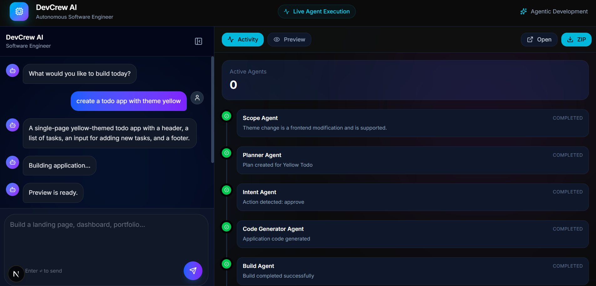
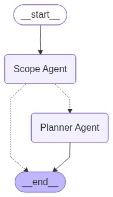
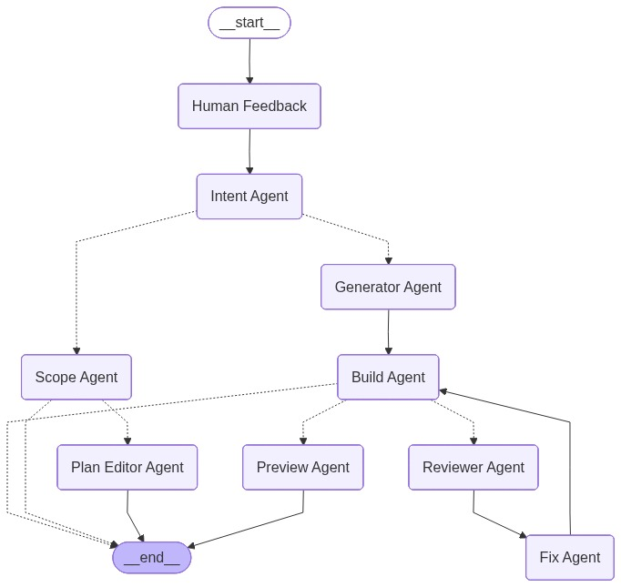
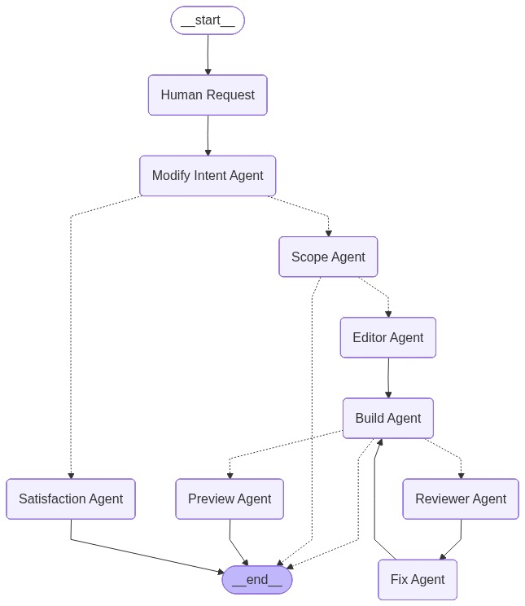

# 🚀 DevCrew AI

> AI Software Engineer powered by Agentic AI, LangGraph, FastAPI, and Next.js.

DevCrew AI is an autonomous software engineering system that can understand product requirements, generate project plans, collaborate with users through Human-in-the-Loop approval, build complete websites, automatically review and fix code, and continuously modify generated applications through natural language instructions.

The goal of this project is to demonstrate how multiple AI agents can collaborate together to perform real software engineering workflows.

---

# ✨ Features

## 📋 AI Project Planning

Generate structured website plans before any code is written.

Example:

```text
Build a modern SaaS landing page for an AI startup.
```

Generated Plan:

- Project Name
- Project Type
- Theme
- Website Sections
- Project Summary

---

## 👨‍💻 Human-in-the-Loop Approval

Before code generation starts:

- User reviews the generated plan
- User approves the plan
- User requests modifications
- AI updates the plan

This ensures generated projects align with user expectations.

---

## 🎯 Scope Validation

The Scope Agent validates whether requests are supported by the platform.

### Supported

- Next.js Applications
- Landing Pages
- Portfolio Websites
- Single Page Applications
- Frontend Projects

### Not Supported

- Databases
- Authentication
- Payments
- Backend APIs
- Mobile Applications
- MERN Stack
- Django
- Spring Boot
- Microservices

---

## 🤖 Autonomous Code Generation

After approval:

```text
Planner
   ↓
Generator Agent
   ↓
Build Agent
   ↓
Preview Agent
```

The system automatically generates a complete Next.js application.

---

## 🔍 Automatic Build Review & Fix Loop

If a build fails:

```text
Build Agent
     ↓
Reviewer Agent
     ↓
Fix Agent
     ↓
Build Agent
```

The loop continues until:

- Build succeeds
- Retry limit is reached

---

## 🛠 Website Modification Agent

Users can continuously improve generated websites.

Examples:

```text
Change theme to dark mode

Add testimonials section

Improve animations

Make the navbar sticky

Add pricing section
```

The Editor Agent directly updates the source code and rebuilds the project.

---

## 😊 Satisfaction Agent

When users are satisfied:

```text
Looks perfect.

Everything is good.

No more changes.
```

The Satisfaction Agent gracefully ends the modification workflow.

---

## ⚡ Real-Time Agent Monitoring

All agent activity is streamed through WebSockets.

Example:

```text
Scope Agent            Running
Planner Agent          Completed
Generator Agent        Running
Build Agent            Running
Reviewer Agent         Completed
Preview Agent          Completed
```

---

## 🌐 Live Preview

Generated websites are automatically launched.

Users can:

- Preview inside DevCrew AI
- Open Preview in Browser

---

## 📦 Download Project

Download generated applications as ZIP files.

Useful for:

- Deployment
- Further Development
- Portfolio Projects

---

# 🧠 Agent Architecture

DevCrew AI uses multiple specialized AI agents.

| Agent | Responsibility |
|---------|---------------|
| Scope Agent | Validates project scope |
| Planner Agent | Creates project plan |
| Intent Agent | Understands user approval/modification intent |
| Plan Editor Agent | Updates project plans |
| Generator Agent | Generates application code |
| Build Agent | Runs project build |
| Reviewer Agent | Reviews build failures |
| Fix Agent | Fixes code issues |
| Modify Intent Agent | Understands modification requests |
| Editor Agent | Updates generated code |
| Satisfaction Agent | Handles user satisfaction |
| Preview Agent | Launches project preview |

---

# 🔄 Workflow Architecture

## 1. Project Planning Flow

```text
User Prompt
      │
      ▼
Scope Agent
      │
 ┌────┴────┐
 │         │
Valid    Invalid
 │         │
 ▼         ▼
Planner   End
 Agent
   │
   ▼
Human Approval
```

---

## 2. Plan Approval Flow

```text
Human Feedback
       │
       ▼
Intent Agent
       │
 ┌─────┴─────┐
 │           │
Approve   Modify Plan
 │           │
 ▼           ▼
Generate   Scope Agent
Project        │
               ▼
         Plan Editor
               │
               ▼
        Human Approval
```

---

## 3. Code Generation Flow

```text
Generator Agent
        │
        ▼
Build Agent
        │
 ┌──────┴──────┐
 │             │
Success      Failed
 │             │
 ▼             ▼
Preview     Reviewer
 Agent       Agent
               │
               ▼
            Fix Agent
               │
               ▼
           Build Agent
```

---

## 4. Website Modification Flow

```text
User Modification
        │
        ▼
Modify Intent Agent
        │
 ┌──────┴──────┐
 │             │
Satisfied    Modify
 │             │
 ▼             ▼
Satisfaction  Scope Agent
 Agent            │
                  ▼
             Editor Agent
                  │
                  ▼
              Build Agent
                  │
                  ▼
             Preview Agent
```

---

# 🏗 Tech Stack

## Frontend

- Next.js 15
- React
- TypeScript
- Tailwind CSS
- Framer Motion
- Lucide React

---

## Backend

- FastAPI
- LangGraph
- LangChain
- WebSockets
- Uvicorn

---

## AI Models

- OpenAI Compatible APIs
- Agent-based Workflow Design

---

# 📂 Project Structure

```text
DevCrew-AI
│
├── backend
│   │
│   ├── agents
│   ├── graph
│   ├── routers
│   ├── services
│   ├── websocket
│   ├── tools
│   └── main.py
│
├── frontend
│   │
│   ├── app
│   ├── components
│   ├── hooks
│   ├── lib
│   └── types
│
└── docs
```

---

# 🚀 Running Locally

## Backend

```bash
cd backend

python -m venv venv

venv\Scripts\activate

pip install -r requirements.txt

uvicorn app.main:app --reload
```

Backend:

```text
http://localhost:8000
```

---

## Frontend

```bash
cd frontend

npm install

npm run dev
```

Frontend:

```text
http://localhost:3000
```

---

# 📸 Screenshots

Add your screenshots here.

<!-- ```md -->








<!-- ``` -->

---

# 🎯 Learning Outcomes

This project demonstrates:

- Agentic AI Systems
- LangGraph Workflows
- Human-in-the-Loop Design
- AI Planning Systems
- Autonomous Code Generation
- Multi-Agent Collaboration
- Real-Time Event Streaming
- FastAPI Backend Development
- Next.js Frontend Development
- AI Product Engineering

---

# 🔮 Future Improvements

### Platform

- Multi-page Applications
- Component-level Editing
- Project Templates
- Better Memory Management

### AI

- Long-Term Memory
- Autonomous Testing Agent
- Deployment Agent
- Design Agent
- Research Agent

### Integrations

- Docker Support
- GitHub Integration
- Vercel Deployment(future implementation)
- MCP Support(future implementation)
- Database Support(future implementation)

---

# 👨‍💻 Author

**Yash Kr Choudhary**

Engineering Student • AI Engineer

Built to explore:

- Agentic AI
- LangGraph
- Human-in-the-Loop Systems
- Autonomous Software Engineering
- AI Product Development

---
